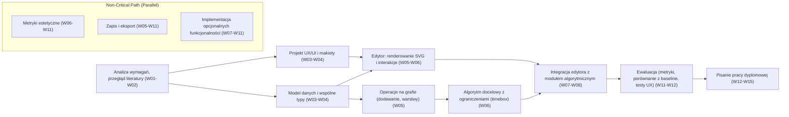

# Project Schedule and Critical Path Analysis

**Winter Semester – MIS WUT Project Team**

---

## 1. Calendar Assumptions and Defensive Schedule Strategy

* Czas trwania semestru: 15 tygodni dydaktycznych.
* Ostateczny termin przesłania pracy dyplomowej do systemu APD: **1 lutego 2027 r.**.
* Zgodnie z wytycznymi dotyczącymi wykładu L1 harmonogram przewiduje **2-tygodniowy okres „Code Freeze”** w 12. tygodniu, aby uniknąć konieczności wykonywania prac w ostatniej chwili w styczniu.


---

## 2. Plan tygodniowy (15 tygodni)

```
[Tydzień 01-03] Etap 1: Rozpisanie wymagań, Podział na MVP i funkcje opcjonalne, Research dostępnych narzędzi i technologii, Analiza ryzyka.
[Tydzień 04] Etap 2: Zdefiniowanie modeli, architektury, komunikacji między modułami, Wybór algorytmu(-ów) do rozmieszczania symboli.
[Tydzień 05-06] Etap 3: Implementacja poszczególnych komponentów MVP, Testy jednostkowe.
[Tydzień 07-08] Etap 4: Integracja modułów, Testy integracyjne, Pierwsza funkcjonalna wersja aplikacji, Prezentacja aplikacji promotorowi i zebranie informacji o ewentualnych koniecznych poprawkach.
[Tydzień 09-11] Etap 5: Bufor zapasowy czasu w razie potrzeby, Inkrementalna implementacja, testowanie i integracja dodatkowych funkcjonalności.
[Tydzień 12]    CODE FREEZE! Zakończenie prac nad aplikacją.
[Tydzień 13-14] Etap 6: Prezentacja finalnej wersji aplikacji promotorowi, Ewaluacja wydajności, Pisanie pracy dyplomowej
[Tydzień 15]    Uzyskanie oceny od promotora, Przygotowanie wersji do wysłania do APD, Przygotowanie prezentacji na obronę
[Luty]   Wysłanie projektu do APD i obrona pracy.
```

|        Week        | Milestone / Stage         | Scope of Work                                                                        | Accountable (RACI: A) |    Risk Buffer    |
| :----------------: | :------------------------ | :----------------------------------------------------------------------------------- | :-------------------: | :---------------: |
| **W01–W02** | Ustalenia wstępne         | Ustalenie zakresu projektu z promotorem, podział zadań, ustalenie zasad współpracy i komunikacji, utworzenie i konfiguracja repozytorium                |    Anna Babicka    |       None       |
|   **W03**   | **Etap 1 (Lab)**   | Oddanie do akceptacji dokumentu określającego wymagania funkcjonalne i niefunkcjonalne, MVP, analizę ryzyka, harmonogram i podział zadań w zespole. |    Anna Babicka    |      3 dni      |
|   **W04**   | Projekt architektury          | Określenie architektury modułów, zdefiniowanie zasad komunikacji między nimi, ustalenie modelu danych |       Bob Nowak       |       None       |
|   **W05**   | **Etap 2 (Lab)**   | Oddanie do akceptacji dokumentu określającego architekturę aplikacji |       Wszyscy       |      2 dni     |
| **W05–W06** | Implementacja algorytmu | Implementacja algorytmu rozmieszczania symboli + testy jednostkowe |   Anna Babicka   |  None  |
| **W05–W06** | Implementacja wyświetlania symboli | Implementacja wyświetlania symboli w edytorze |   Wiktor Murawski   |  None  |
| **W05–W06** | Implementacja interfejsu graficznego | Implementacja interfejsu graficznego edytora |   Wiktor Murawski   |  None  |
|   **W08**   | **Stage 3 (Lab)**   | Oddanie implementacji podstawowych funkcji |   Wszyscy   |      4 dni      |
| **W07–W08** | Integracja          | Integracja edytora z modułem algorytmicznym, CI Pipeline |   Anna Babicka   |   Nov 1 Holiday   |
|   **W11**   | **Stage 4 (Lab)**   | Oddanie pierwszej wersji działającej aplikacji oraz raportu z testów integracyjnych |   Wszyscy   |      3 days      |
|   **W09-W11**   | Implementacja dodatkowych funkcji | Inkrementalna implementacja funkcji spoza MVP |   Wszyscy   |      koniec W11      |
|   **W12**   | **FEATURE FREEZE**  | Całkowite wstrzymanie wprowadzania nowych funkcji. System jest w 100% stabilny                                  |       Everyone       | **2 tygodnie** |
|   **W13**   | **Stage 5 (Lab)**   | **Finalne zatwierdzenie aplikacji**, instrukcja użytkowania i uruchomienia |       Wszyscy       |       None       |
|   **W13**   | Ewaluacja | testy wydajnościowe, zebranie wyników skuteczności algorytmu |  Anna Babicka  |   None   |
|   **W14-W15**   | Finalizacja pracy pisemnej | Edycja tekstu, deklaracja użycia AI, sprawdzenie antyplagiatowe |    Wszyscy    |      5 dni      |
| **January** | Przesłanie projektu do APD            | Stworzenie pakietu do wysłania do APD, uzyskanie akceptacji promotora i recenzenta |       Everyone       |    Do 1 lutego   |

---

## 3. Critical Path Identification

Ścieżka krytyczna to najdłuższy ciąg zadań zależnych od siebie, od startu do oddania projektu. Opóźnienie dowolnego zadania na tej ścieżce opóźnia cały projekt. Zadania spoza niej mają zapas czasu (slack), czyli mogą się przesunąć bez wpływu na termin końcowy.



> [!WARNING] ⚠️ **Critical Path Note:**
> Any delays in data ingestion modules and the analytical pipeline directly delay the execution of benchmarks (Chapter 4), making timely thesis submission to APD impossible. These tasks are subject to weekly review.
