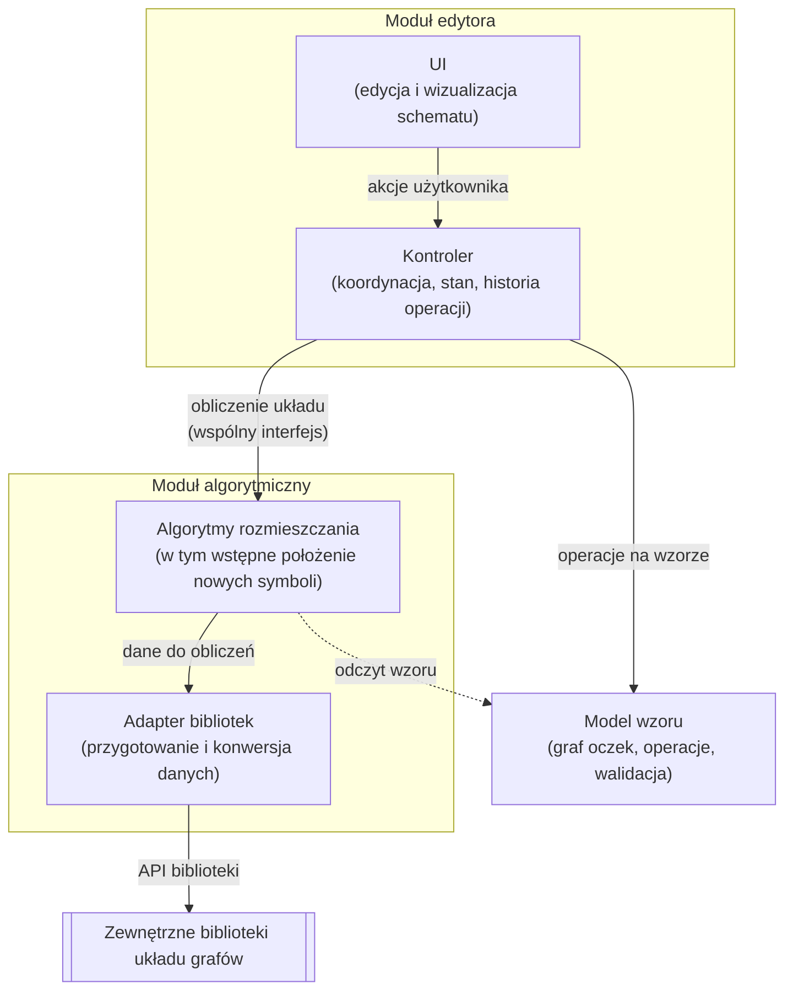

# Etap 2: Architektura systemu and projekt techniczny (System Architecture & Technical Design)

**Engineering / Master's Project – Faculty of MIS PW**

---

## 1. Architektura systemu

Diagram przedstawia ogólną, logiczną architekturę systemu: główne moduły aplikacji i zależności między nimi, bez odwołań do konkretnych technologii. Strzałki wskazują kierunek wywołań między modułami; moduł wywoływany zwraca wynik do modułu wywołującego. Linia przerywana oznacza dostęp tylko do odczytu.

System składa się z trzech głównych części. Moduł edytora odpowiada za interakcję z użytkownikiem. Warstwa UI umożliwia edycję i wyświetla schemat, a kontroler koordynuje przepływ informacji między interfejsem a pozostałymi modułami. Kontroler przechowuje także bieżący stan aplikacji i historię operacji, dzięki czemu warstwa UI jest odizolowana od logiki dziedzinowej.

Model wzoru przechowuje formalną reprezentację wzoru w postaci grafu oczek wraz z operacjami jego modyfikacji i regułami zapewniającymi, że wzór jest możliwy do wykonania. Stanowi jedyne źródło danych o strukturze wzoru. Zmiany wprowadza wyłącznie kontroler, a moduł algorytmiczny jedynie odczytuje strukturę wzoru.

Moduł algorytmiczny na podstawie struktury wzoru wyznacza układ symboli na schemacie, w tym wstępne położenie nowo dodanych elementów. Komunikuje się z kontrolerem przez wspólny interfejs, co pozwala rozwijać edytor i algorytm niezależnie. W razie potrzeby korzysta z zewnętrznych bibliotek układu grafów. Komunikację z nimi obsługuje adapter, który przygotowuje dane w wymaganym formacie i przekształca wyniki. Dzięki temu zmiana wykorzystywanej biblioteki nie wpływa na pozostałe elementy systemu.

Taki podział oddziela strukturę wzoru od jego reprezentacji graficznej: model opisuje, co zostało zaprojektowane, moduł algorytmiczny określa, jak przedstawić to na schemacie, a edytor pośredniczy między użytkownikiem a tymi dwoma modułami.



---

## 2. Stos technologiczny

Poniższa tabela przedstawia technologie przyjęte w projekcie wraz z rozważanymi alternatywami i uzasadnieniem wyboru. Aplikacja działa w całości w przeglądarce, dlatego narzędzia takie jak Node.js czy Vite są wykorzystywane wyłącznie na etapie tworzenia, testowania i budowania aplikacji.gi

| Moduł / Komponent | Wybrana technologia | Rozważane alternatywy | Uzasadnienie wyboru                                                                                                                            |
| :-------------------- | :--------------------------------------- | :------------------------ | :------------------------------------------------------------------------------------------------------------------------------------------------------ |
| **Platforma** | **aplikacja webowa** | Aplikacja desktopa: WPF/C#, Avalonia/C#, Electron | dostęp bez instalacji, jedna implementacja dla różnych systemów. |
| **Framework** | **React** | Vue | Dojrzały ekosystem, model komponentowy, dobra współpraca z niemutowalnym stanem. |
| **Język** | **TypeScript** | JavaScript | Statyczne typowanie złożonego modelu danych, bezpieczniejsza refaktoryzacja, wspólne kontrakty między modułami. |
| **Renderowanie schematu** | **SVG**      | Canvas (Konva / react-konva), czysty HTML Canvas | Grafika wektorowa, każdy symbol jako osobny element, naturalny format eksportu; Canvas wymagałby osobnego eksportu do SVG i własnej obsługi zaznaczania. |
| **Narzędzie budowania** | **Vite** | Webpack | Szybki serwer deweloperski, gotowa obsługa TypeScriptu i Reacta. |
| **Środowisko uruchomieniowe**  | **Node.js + npm** | npm dostępny razem z Node.js bez dodatkowej instalacji i domyślnie wspierany przez narzędzia projektu oraz GitHub Actions; wersje przypięte w .nvmrc i lockfile’u zapewniają powtarzalność środowiska. |
| **Repozytorium i CI/CD** | **GitHub, GitHub Actions** | GitLab CI | Code review przez pull requesty, automatyczne testy przy każdej zmianie, wcześniejsze doświadczenie z GitHub Actions. |

---

## 3. API Contracts (OpenAPI / Swagger Specification)

### Measurement Ingestion Endpoint: `POST /api/v1/metrics`

* **Headers:** `Content-Type: application/json`, `Authorization: Bearer <token>`
* **Request Body:**

```json
{
  "sensor_id": "sensor-alpha-001",
  "timestamp": "2024-10-24T14:30:00Z",
  "metric_name": "temperature_celsius",
  "value": 24.85,
  "tags": {
    "location": "lab-412",
    "device_model": "ESP32"
  }
}
```

* **Response (Response 201 Created):**

```json
{
  "status": "success",
  "metric_id": 982341,
  "is_anomaly": false,
  "anomaly_score": 0.12
}
```

### Historical Query Endpoint: `GET /api/v1/sensors/{sensor_id}/metrics`

* **URL Parameters:** `from=2024-10-24T00:00:00Z&to=2024-10-24T23:59:59Z&limit=1000`
* **Response (Response 200 OK):** Returns an array of measurement points along with anomaly markers and model confidence levels.

---

## 4. Database Schema (Relational ERD)

```sql
-- Sensors and metadata table
CREATE TABLE sensors (
    sensor_id VARCHAR(64) PRIMARY KEY,
    name VARCHAR(128) NOT NULL,
    device_model VARCHAR(64),
    created_at TIMESTAMPTZ DEFAULT NOW()
);

-- Time series hypertable (TimescaleDB)
CREATE TABLE sensor_metrics (
    time TIMESTAMPTZ NOT NULL,
    sensor_id VARCHAR(64) REFERENCES sensors(sensor_id),
    metric_name VARCHAR(64) NOT NULL,
    value DOUBLE PRECISION NOT NULL,
    is_anomaly BOOLEAN DEFAULT FALSE,
    anomaly_score DOUBLE PRECISION DEFAULT 0.0
);

SELECT create_hypertable('sensor_metrics', 'time');
```

---

## 5. Deployment Topology and Security

* All services communicate within an isolated Docker virtual network (`datastream-net`).
* Database data is persisted in the volume `datastream_pgdata`.
* External access is limited to port 8000 (API) and port 3000 (UI).
* Password and key configurations are passed exclusively through environment variables from the `.env` file (template in `.env.example`).

---

## 6. Team Independence Verification (Modular Independence Check)

* [X] **Task Separation:** Defined OpenAPI contracts allow parallel work by the Frontend developer (Carol) and Backend developer (Bob) using generated mock data.
* [X] **Isolation of Analytical Engine:** The anomaly detection module (David) communicates solely through the Redis broker, not blocking the development of the database and API.

---

**Supervisor Signature (Architecture Acceptance):** ............................................ **Date:** 05.11.2026
